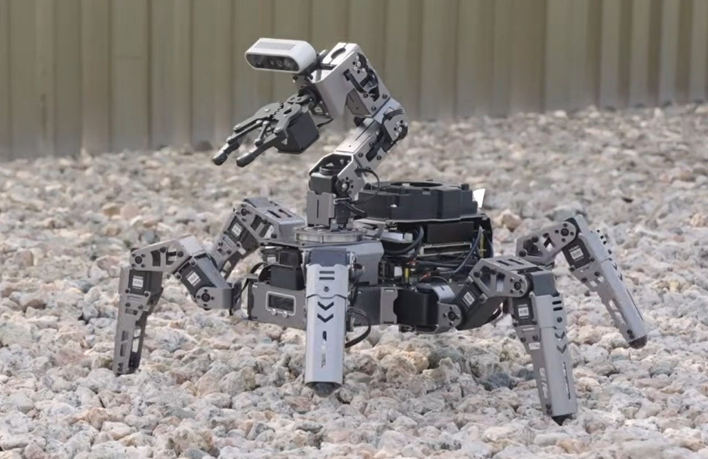

# Entech × Hiwonder ROS 2

ไทย | [English](README.en.md)

รวมโค้ด ROS 2 ของหุ่นยนต์ Hiwonder ที่ Entech ใช้สอนและพัฒนาต่อ โดยแยก **หนึ่งโฟลเดอร์ต่อหนึ่งรุ่นหุ่น** และแต่ละโฟลเดอร์เป็น colcon workspace ของตัวเอง จะมีรุ่นอื่นเพิ่มเข้ามาเรื่อย ๆ

<p align="center">
  
</p>

## หุ่นยนต์ในรีโปนี้

| รุ่น | หุ่น | หุ่นจริง | Simulation (PC) | เอกสาร |
|---|---|---|---|---|
| [ROSpider](ROSpider/) | หุ่นแมงมุม 6 ขา (18 servo) + แขนกล, กล้อง depth, LiDAR | Jetson, Ubuntu 22.04, ROS 2 Humble | Ubuntu 24.04, ROS 2 Jazzy, Gazebo Harmonic | [README](ROSpider/README.md) (sim + โจทย์เวิร์กช็อป), [REAL_ROBOT](ROSpider/REAL_ROBOT.md) (หุ่นจริง), [Hiwonder docs](https://docs.hiwonder.com/projects/ROSpider/en/jetson-orin-nano-version/) |

## โครงสร้าง

```
hiwonder_ros2/
├── README.md          ← ไฟล์นี้
├── README.en.md       ไฟล์นี้ฉบับภาษาอังกฤษ
├── CLAUDE.md          บันทึกเทคนิคสำหรับนักพัฒนา (ภาษาอังกฤษ)
├── docs/              spec และแผนงานของฟีเจอร์ที่ทำเพิ่ม
└── ROSpider/          colcon workspace ของ ROSpider
```

## กติกาสำคัญ

- **build จากในโฟลเดอร์ของรุ่นนั้นเท่านั้น** ห้ามรัน `colcon build` ที่โฟลเดอร์นี้ เพราะหุ่นแต่ละรุ่นของ Hiwonder ใช้ชื่อ package ซ้ำกัน (`app`, `bringup`, `controller`, ...) และ colcon ไม่ยอมให้ชื่อซ้ำ
- **อย่า source `install/` ของสองรุ่นใน terminal เดียวกัน**
- โค้ดของแต่ละรุ่นดึงมาจากรีโปของ Hiwonder ด้วย `git subtree` (เก็บประวัติเดิมไว้) ส่วนที่ Entech เพิ่มอยู่ในรีโปนี้

## ติดตั้งและ build (ครั้งแรก)

ต้องติดตั้ง ROS 2 Jazzy (`ros-jazzy-desktop`) ไว้ก่อน ตาม[คู่มือของ ROS](https://docs.ros.org/en/jazzy/Installation/Ubuntu-Install-Debs.html)

```bash
sudo apt install git python3-rosdep python3-colcon-common-extensions
sudo rosdep init   # ครั้งเดียวต่อเครื่อง ถ้าขึ้นว่ามีไฟล์อยู่แล้วก็ไม่เป็นไร
rosdep update
cd ~
git clone https://github.com/ENTECH-Industrial-Solution/hiwonder_ros2.git
cd ~/hiwonder_ros2/ROSpider
source /opt/ros/jazzy/setup.bash
rosdep install --from-paths src --ignore-src -r -y
colcon build --symlink-install
echo " " >> ~/.bashrc
echo "#Hiwonder" >> ~/.bashrc
echo "source ~/hiwonder_ros2/ROSpider/env.bash" >> ~/.bashrc
echo "source ~/hiwonder_ros2/ROSpider/install/setup.bash" >> ~/.bashrc
```

บรรทัดสุดท้ายทำให้ทุก terminal ที่เปิดใหม่โหลด [env.bash](ROSpider/env.bash) เอง (ROS 2, workspace นี้ และค่าที่ซิมต้องใช้) terminal ที่เปิดค้างไว้ก่อนหน้า ให้ปิดแล้วเปิดใหม่

ใน env.bash มี `ROS_AUTOMATIC_DISCOVERY_RANGE=LOCALHOST` กับ `GZ_IP=127.0.0.1` ซึ่งทำให้ ROS และ Gazebo คุยกันแค่ในเครื่องตัวเอง ถ้าไม่ตั้ง ซิมทุกเครื่องในเครือข่ายเดียวกันจะเห็น topic ของกันและกัน (`/clock`, `/controller/cmd_vel`, ...) เวลาของซิมจะกระโดดไปมา แล้วหุ่นจะไม่เดินตาม teleop

## ถอนการติดตั้ง

ลบบรรทัดของ workspace นี้ออกจาก `~/.bashrc`, ลบโฟลเดอร์ repo (รวม build), และลบค่าที่หน้าต่างปรับตั้งบันทึกไว้:

```bash
sed -i '\|hiwonder_ros2/ROSpider/|d' ~/.bashrc
rm -rf ~/hiwonder_ros2
rm -f ~/.ros/{apriltag,color_challenge,color_detect,yolo_detect}_tuned.json
```

จากนั้นปิด terminal ที่เปิดอยู่ทั้งหมด (terminal เดิมยังจำค่าจาก env.bash ไว้) แผนที่หรือไฟล์ที่บันทึกไว้นอกโฟลเดอร์ repo ต้องลบเอง แพ็กเกจที่ `apt` และ `rosdep` ติดตั้งให้ไม่ต้องลบ เพราะเป็นของ ROS ที่งานอื่นอาจใช้อยู่

## อัปเดตโค้ดจาก Hiwonder

```bash
git subtree pull --prefix=ROSpider hiwonder Jetson_Nano_ROS2
```

remote `hiwonder` คือ https://github.com/Hiwonder/ROSpider.git

## เพิ่มหุ่นรุ่นใหม่

1. `git remote add <ชื่อ> <URL รีโป Hiwonder>`
2. `git subtree add --prefix=<ชื่อรุ่น> <ชื่อ> <branch>`
3. เพิ่มแถวในตาราง "หุ่นยนต์ในรีโปนี้" ด้านบน (ทั้งสองภาษา)
